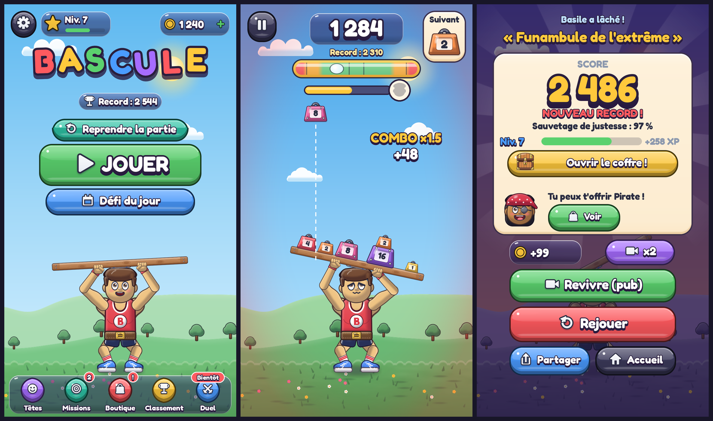
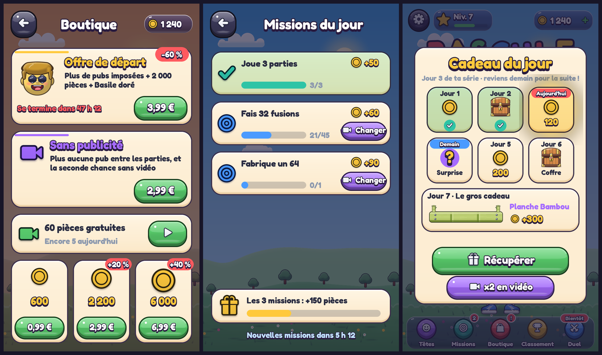

# Bascule

Jeu mobile gratuit (Android et iOS) à score infini. Le joueur aide une mascotte à tenir une planche en équilibre en y faisant tomber des poids. Projet Unity, construit d'après le cahier des charges du jeu.



> Ces écrans sont assemblés hors Unity (`Tools/scene_preview.py`) avec **les mêmes images** que le jeu (dessinées par le code de `Assets/Bascule/Scripts/Core`) et les mêmes positions. Le rendu final est celui de Unity. Autres aperçus : [les 62 têtes](docs/apercu/tetes.png), [les humeurs de la mascotte](docs/apercu/expressions.png), [les poids](docs/apercu/poids.png).

## Démarrer en 3 minutes

1. Installer **Unity 6** (n'importe quelle version 6000.x LTS) avec les modules **Web Build Support**, et **Android Build Support** et/ou **iOS Build Support** selon le téléphone visé.
2. Unity Hub → **Add** → **Add project from disk** → choisir ce dossier. Si Unity Hub propose une autre version de l'éditeur, accepter.
3. À la première ouverture, le menu **Bascule** configure tout seul le projet : portrait, identifiant `fr.orpheex.bascule`, version, icône, écran de chargement, scène `Assets/Bascule/Scenes/Main.unity`. Pour relancer cette configuration : **Bascule → Configurer le projet**.
4. Dans la vue **Game**, choisir une résolution portrait (par exemple 1080 × 1920), puis **Play**. On vise à la souris : on clique, on glisse, on relâche.

Rien n'est à câbler dans l'éditeur : `GameApp` construit le jeu par le code au lancement (caméra, monde, interface, sons). Les images sont dessinées par le code puis rangées à l'avance dans `Resources/ArtPack` (rien n'est calculé au lancement). La musique est dans `Resources/Musique`, les bruitages sont synthétisés.

## Jouer sur son téléphone

**Le plus rapide : la version web**, sans Mac et sans compte développeur.
1. Menu **Bascule → Version web**. Le jeu est construit dans `Builds/Bascule_Web`, avec la page de chargement Bascule.
2. Compresser ce dossier en `.zip`.
3. Sur [itch.io](https://itch.io), faire **Upload new project** :
   - *Kind of project* : **HTML** ;
   - envoyer le zip et cocher **This file will be played in the browser** ;
   - cocher **Mobile friendly**, puis **Orientation : Portrait** ;
   - cocher **Fullscreen button** ;
   - visibilité **Draft** ou **Restricted** pour tester entre amis.
4. Sur l'iPhone, ouvrir le lien dans Safari, puis **Partager → Sur l'écran d'accueil** : le jeu s'ouvre en plein écran comme une appli, avec son icône.

**L'application** (pour les stores) :
- **Android** : menu **Bascule → Android : construire l'APK de test**, puis installer l'APK sur le téléphone.
- **iOS** : File → Build Profiles → iOS → *Switch Platform* → **Build**, puis ouvrir le projet Xcode sur un Mac et le signer avec un compte Apple Developer.

## Les guides

| Sujet | Fichier |
|---|---|
| Brancher le classement en ligne, les pubs, les achats, les rappels | `docs/INTEGRATIONS.md` |
| Économie : à quoi servent les pièces (rien ne change le score) | `docs/ECONOMIE.md` |
| Partage sur les réseaux (carte, résumé, mode vidéo) | `docs/PARTAGE.md` |
| Fiche store prête à copier | `docs/STORE.md` |
| Pages légales à mettre sur orpheex.fr | `docs/site/bascule` |
| Ce qui a changé, version par version | `docs/VERSIONS.md` |
| Rétention et revenus (modèle de 1000 joueurs) | `docs/RAPPORT.md` |

## Direction artistique

Style « illustration de jeu mobile » : volumes en dégradé doux, ombre propre, contour sombre coloré, reflets.

- **Mascotte articulée** (`Core/MascotArt.cs`, `Runtime/Game/MascotView.cs`) : débardeur à l'emblème B, ceinture d'haltérophile, short, chaussettes rayées, baskets, bras musclés avec bandeaux de poignet, serviette roulée sous la planche. Coudes et genoux plient par cinématique inverse : elle s'accroupit sous la charge, ses bras suivent la planche, ses pieds glissent quand ça force, elle transpire, saute quand le 128 s'envole et lâche à la défaite.
- **Têtes** (`Core/Art.cs`) : yeux avec iris et reflets, paupières, sourcils, nez, bouche avec dents et langue, cheveux en volume avec mèches de lumière, accessoires (casquette, bonnet, couronne, lunettes…). 12 expressions.
- **Poids** (`Core/WeightArt.cs`) : poids en fonte émaillée de dessin animé, anse en fer, plaque gravée pour le chiffre, rivets à partir du 8, dorures à partir du 32, étoile sur le 64 et le 128.
- **Décor** (`Core/SceneArt.cs`, `Runtime/Game/Backdrop.cs`) : ciel en dégradé, soleil, nuages qui dérivent, collines avec arbres, prairie fleurie, planche en bois veiné. L'ambiance avance dans la journée avec le score (matin, midi, doré, couchant, nuit) avec un fondu.
- **Interface** (`Core/UiArt.cs`, `Runtime/UI`) : boutons « bonbon » en relief avec icônes, textes blancs cernés, cartes crème, **niveau à bulle** comme jauge de stabilité, barre de progression vers la prochaine tête, voile rouge en cas de danger.
- **Retours visuels** (`Runtime/Game/Effects.cs`) : poussière à l'atterrissage, poids qui s'écrase et rebondit, onde de choc et étincelles à la fusion, textes qui jaillissent, ralenti sur les sauvetages de justesse, confettis au record et au 128, secousses de caméra.

### Tester sur téléphone pendant le développement

- **Android** : File → Build Profiles → Android → *Switch Platform*, brancher le téléphone (mode développeur et débogage USB), **Build And Run**.
- L'application **Unity Remote 5** affiche la vue Game sur le téléphone pendant le Play (avec un peu de décalage).

## Régler le jeu sans recoder

Tous les réglages sont dans **`Assets/Bascule/Resources/bascule_tuning.json`** (menu **Bascule → Ouvrir les réglages de jeu**) : force et sens de la bascule, amortissement, angle de défaite, taille et glisse des poids, chances de chaque poids par palier, points, combo, seuils d'humeur de la mascotte. Chaque bloc contient une clé `_aide` qui explique ses valeurs.

- Dans l'éditeur, le fichier est relu à chaque lancement. En jeu : **Réglages → Prototype → Recharger les réglages**.
- **Réglages → Prototype → Sens de bascule** permet de comparer en direct « vers le lourd » et « vers le léger » (question 1 de la section 13 du cahier des charges).
- Pour dégrossir un réglage avant de le tester à la main, la simulation fait jouer des centaines de parties automatiques :

```bash
pip install pymunk
```

```bash
python3 Tools/balance_sim.py 20
```

```bash
TUNE="plank.degreesPerTorque=3.0,weights.friction=0.35" python3 Tools/balance_sim.py 20
```

## Ce qui est fait

| Cahier des charges | Où |
|---|---|
| Boucle de jeu : viser en glissant, relâcher, atterrir, fusionner, perdre les poids qui tombent, défaite (§2) | `Runtime/Game/GameSession.cs` |
| Poids 1 à 128, couleur et chiffre, taille plafonnée, poids suivant affiché, 128 en montgolfière (§3) | `Core/WeightCatalog.cs`, `Runtime/Game/WorldBits.cs`, `Runtime/Game/Effects.cs` |
| Planche progressive et amortie, angle borné, réglages dans un fichier séparé (§4) | `Core/PlankModel.cs`, `bascule_tuning.json` |
| Mascotte : 4 états selon l'inclinaison, réactions aux fusions, au 128, à la défaite ; tassement sous la charge (§5) | `Runtime/Game/MascotView.cs`, `Core/Mascot.cs` |
| 40 têtes (33 par palier de score, 6 spéciales, 1 de départ), collection (§5) | `Core/HeadCatalog.cs`, écran Collection |
| Score, combo en chaîne, bonus montgolfière, difficulté croissante, planche qui raccourcit (§6) | `Core/ScoreKeeper.cs`, `Core/SpawnSequence.cs` |
| Défi du jour (même suite pour tous, série de jours), duel par code, reprise après avoir quitté l'appli (§7) | `Core/Profile.cs` (`Daily`), `Core/ChallengeCode.cs`, `Runtime/Services/SaveService.cs` |
| Carte de score (score, tête, sauvetage de justesse, code défi), partage, classement monde et jour, pseudo (§8) | `Runtime/UI/ScoreCard.cs`, `Runtime/Services/LeaderboardService.cs` |
| Seconde chance par pub récompensée, achat « retirer les pubs », écran de confidentialité (§9) | `Runtime/Services/MonetizationServices.cs` |
| Écrans : accueil, partie, pause, fin, collection, classement, réglages (§11) | `Runtime/UI/Screens.cs` |
| Progression : XP et niveaux, pièces, 3 missions par jour, cadeau du jour sur 7 jours, 62 têtes (record, niveau, boutique, exploits, premium), tutoriel de la 1re partie | `Core/Economy.cs`, `Core/HeadCatalog.cs`, `Runtime/UI/MetaScreens.cs` |
| Argent : boutique (offre de départ, sans pub, pièces, pack Légendes), pubs récompensées au choix, pubs imposées encadrées (`AdPolicy`) | `Core/Economy.cs`, `Runtime/Services/MonetizationServices.cs` |
| Rappels locaux, demande de note, statistiques d'usage anonymes | `Runtime/Services/EngagementServices.cs` |
| Une main, chiffre sur chaque poids, texte ≥ 44 px et taille réglable, hors ligne, 60 i/s, sauvegarde locale, FR/EN (§12) | partout ; `Core/Loc.cs` |

## Rétention et argent : rapport de simulation

Une simulation de 1000 joueurs a servi à régler la collection, les récompenses et le rythme des pubs : [docs/RAPPORT.md](docs/RAPPORT.md). Aperçus des nouveaux écrans : 

```bash
python3 Tools/game_library.py 80
```

```bash
python3 Tools/player_sim.py 1000 60
```

## Ce qu'il reste à brancher

Ces éléments demandent vos comptes (Google Play, Apple, Unity Gaming Services, régie pub). Le code est prêt à les recevoir ; marche à suivre dans [docs/INTEGRATIONS.md](docs/INTEGRATIONS.md) :

- **Classement en ligne** : installer le paquet *Leaderboards* de Unity Gaming Services. Le code s'active tout seul (`UgsLeaderboardService.cs`). Sans lui, les scores attendent dans la sauvegarde et partent au prochain lancement connecté.
- **Partage natif** (WhatsApp, Snapchat, Instagram, TikTok) : installer le paquet gratuit *NativeShare*. Le code s'active tout seul.
- **Publicités** (Unity Ads, non personnalisées) : installer *Advertisement Legacy* et mettre le Game ID dans `GameApp.AdIds`. Le code s'active tout seul.
- **Achats in-app** : installer *In-App Purchasing* 4.x et créer les 6 produits dans les stores. Le code s'active tout seul.
- **Rappels** : installer *Mobile Notifications*. Le code s'active tout seul.
- **Politique de confidentialité** : remplacer l'URL `GameApp.PrivacyUrl`.

## Organisation du code

```
Assets/Bascule/
  Resources/bascule_tuning.json   réglages de gameplay
  Resources/Fonts/                police Fredoka (licence OFL, libre pour un jeu commercial)
  Scripts/Core/      règles du jeu en C# pur, sans Unity : testées hors Unity
  Scripts/Runtime/   le jeu Unity : GameApp (point d'entrée), Game/ (monde), UI/ (écrans), Services/
  Scripts/Editor/    menu « Bascule » : configuration du projet, export des têtes en PNG
Tests/Bascule.Core.Tests/   tests unitaires des règles (dotnet test)
Tools/CompileCheck/         vérifie que les scripts Unity compilent sans ouvrir Unity
Tools/balance_sim.py        simulation d'équilibrage
Tools/game_library.py       400 parties simulées (physique approchée)
Tools/player_sim.py         modèle de 1000 joueurs : rétention, pubs, achats
Tools/ArtPreview            exporte en PNG tous les visuels dessinés par le code
Tools/scene_preview.py      assemble des maquettes d'écrans avec ces visuels
Tools/render_preview.py     planches : têtes, humeurs, poids
docs/                       décisions, intégrations, aperçus
```

Vérifications sans Unity (il faut le SDK .NET 8) :

```bash
dotnet test Tests/Bascule.Core.Tests
```

```bash
dotnet build Tools/CompileCheck
```

## Décisions prises

Le cahier des charges laissait quatre questions ouvertes (section 13). Les choix faits pour le prototype, tous modifiables, sont expliqués dans [docs/DECISIONS.md](docs/DECISIONS.md).
